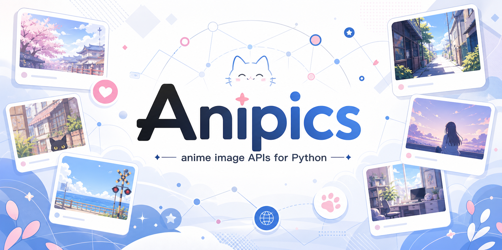

<div align="center">



[](https://pypi.org/project/anipics/)
[](https://pypi.org/project/anipics/)
[](https://pypi.org/project/anipics/)
[](https://github.com/D4n13l3k00/anipics/releases)
[](/LICENSE)
[](https://github.com/psf/black)
[](https://openai.com/codex/)

[PyPI](https://pypi.org/project/anipics/) |
[GitHub Releases](https://github.com/D4n13l3k00/anipics/releases) |
[Examples](/examples)

</div>

## &#127800; About

Anipics wraps several anime image services behind a small sync and async API.
It is designed for bots, small apps, scripts, and experiments where you just
want a clean `url` or typed metadata without hand-writing HTTP calls for every
provider.

## &#128230; Installation

```shell
uv add anipics
```

```shell
pip install anipics
```

## &#128640; Quick Start

```python
from anipics import NekosAPI, WaifuIm

waifu = WaifuIm().get(WaifuIm.Types.waifu)
print(waifu.url)

image = NekosAPI().get_random_image(tags=[NekosAPI.Types.girl])
print(image.id, image.url)
```

Async usage follows the same shape:

```python
import asyncio

from anipics import Nekosia


async def main() -> None:
    image = await Nekosia().async_get(Nekosia.Types.catgirl)
    print(image.url)


asyncio.run(main())
```

More examples live in [`examples/`](/examples). &#10024;

## &#129513; Services

| Service | Best for | Extras |
| --- | --- | --- |
| `NekosAPI` | &#128444;&#65039; Random images and browsable metadata | Typed image metadata models |
| `NekosBest` | &#127916; Reactions, GIFs, waifu/neko/kitsune images | Endpoint discovery |
| `Nekosia` | &#127991;&#65039; Tag/category based anime images | Documented main categories and tag lookup |
| `NekosLife` | &#127769; Classic neko/waifu/avatar style endpoints | Simple URL result API |
| `PurrBot` | &#9889; SFW and NSFW gif/image endpoints | v2 API paths |
| `WaifuIm` | &#127872; Waifu images with include/exclude filters | Tag lookup and NSFW filter options |

## &#10024; Typed Metadata

Most simple calls return `Models.Result` with a `url` field:

```python
from anipics import PurrBot

result = PurrBot().get(PurrBot.Types.SFW.GIF.neko)
print(result.url)
```

`NekosAPI` metadata calls return typed Pydantic models:

```python
from anipics import NekosAPI

image = NekosAPI().get_random_image(tags=[NekosAPI.Types.neko])

print(image.id)
print(image.url)
print(image.rating)
print(image.tags)
```

## &#128736;&#65039; Development

```shell
uv sync
uv run scripts/format.py
uv run scripts/test.py
```

Live tests call external services and are kept separate from the default test
command:

```shell
uv run scripts/live_test.py
```

Build the package with:

```shell
uv build
```

## &#128220; License

Anipics is distributed under the [AGPL-3.0 license](/LICENSE).
