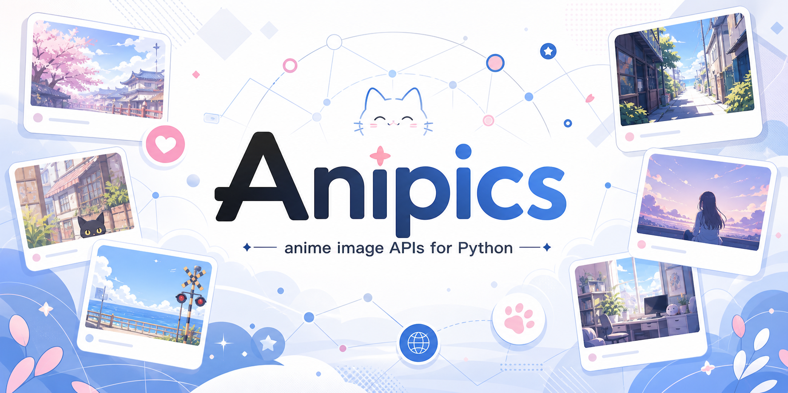

<div align="center">



[](https://pypi.org/project/anipics/)
[](https://pypi.org/project/anipics/)
[](https://pypi.org/project/anipics/)
[](https://github.com/D4n13l3k00/anipics/releases)
[](/LICENSE)
[](https://github.com/psf/black)
[](https://openai.com/codex/)

[PyPI](https://pypi.org/project/anipics/) |
[Релизы на GitHub](https://github.com/D4n13l3k00/anipics/releases) |
[Примеры](/examples)

[English](README.md) | **Русский**

</div>

## &#127800; О библиотеке

Anipics объединяет несколько сервисов аниме-изображений за простым синхронным
и асинхронным API. Подходит для ботов, небольших приложений, скриптов
и экспериментов, где нужен `url` или типизированные метаданные без ручного
написания HTTP-запросов к каждому сервису.

## &#128230; Установка

```shell
uv add anipics
```

```shell
pip install anipics
```

## &#128640; Быстрый старт

```python
from anipics import NekosAPI, NekosBest

waifu = NekosBest().get(NekosBest.Types.waifu)
print(waifu.url)

image = NekosAPI().get_random_image(tags=[NekosAPI.Types.girl])
print(image.id, image.url)
```

Для асинхронных вызовов используется отдельный клиент с теми же именами методов:

```python
import asyncio

from anipics import AsyncNekosia


async def main() -> None:
    image = await AsyncNekosia().get(AsyncNekosia.Types.catgirl)
    print(image.url)


asyncio.run(main())
```

Больше примеров — в [`examples/`](/examples). &#10024;

## &#129513; Сервисы

| Сервис | Назначение | Дополнительно |
| --- | --- | --- |
| `NekosAPI` | &#128444;&#65039; Случайные изображения и просмотр метаданных | Типизированные модели метаданных |
| `NekosBest` | &#127916; Реакции, GIF, изображения waifu/neko/kitsune | Получение доступных эндпоинтов |
| `Nekosia` | &#127991;&#65039; Аниме-изображения по тегам и категориям | Основные категории и получение тегов |
| `NekosLife` | &#127769; Изображения neko, waifu, аватары и другие категории | Простой результат с URL |
| `PurrBot` | &#9889; SFW- и NSFW-изображения и GIF | Эндпоинты API v2 |
| `WaifuBest` | &#127872; Waifu-изображения с включением и исключением тегов | Получение тегов и выбор SFW/NSFW |

## &#10024; Типизированные метаданные

Большинство простых вызовов возвращает `Models.Result` с полем `url`:

```python
from anipics import PurrBot

result = PurrBot().get(PurrBot.Types.SFW.GIF.neko)
print(result.url)
```

Методы получения метаданных `NekosAPI` возвращают типизированные модели Pydantic:

```python
from anipics import NekosAPI

image = NekosAPI().get_random_image(
    tags=[NekosAPI.Types.catgirl], rating=NekosAPI.Ratings.safe
)

print(image.id)
print(image.url)
print(image.rating)
print(image.tags)
```

## &#128736;&#65039; Разработка

```shell
uv sync
uv run scripts/format.py
uv run scripts/test.py
```

Live-тесты обращаются к внешним сервисам и запускаются отдельно от обычных тестов:

```shell
uv run scripts/live_test.py
```

Сборка пакета:

```shell
uv build
```

## &#128220; Лицензия

Anipics распространяется по [лицензии AGPL-3.0](/LICENSE).
